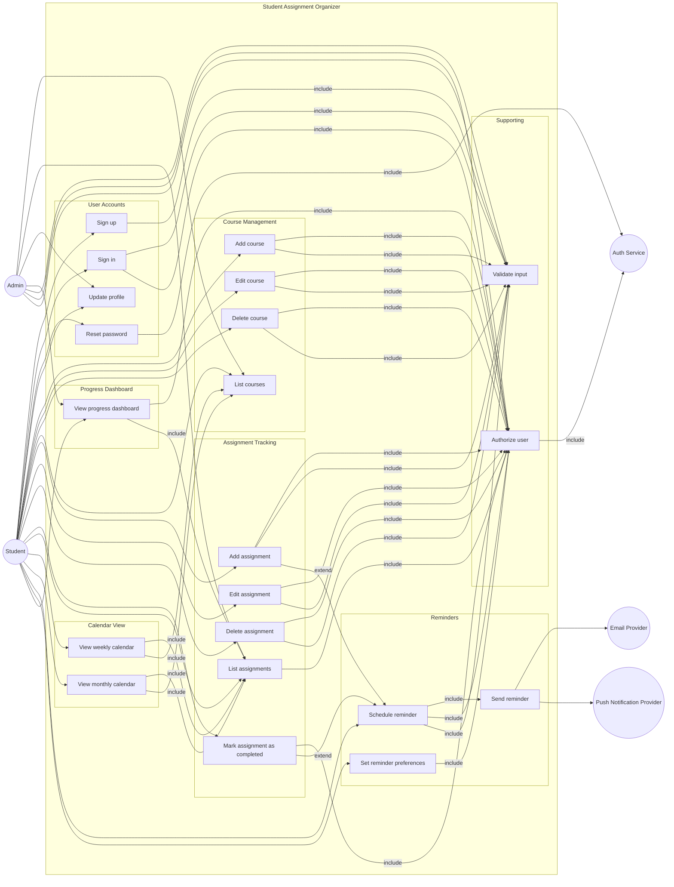
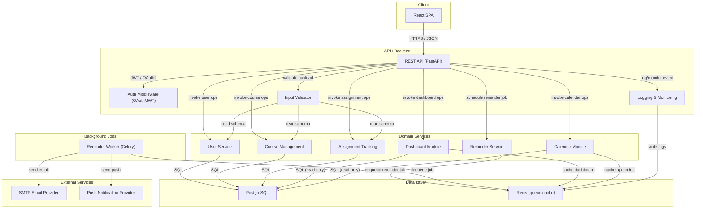
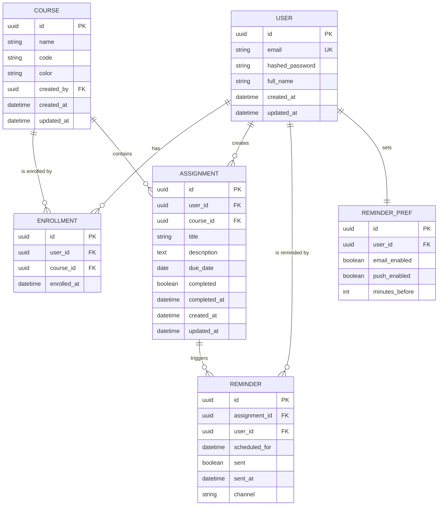
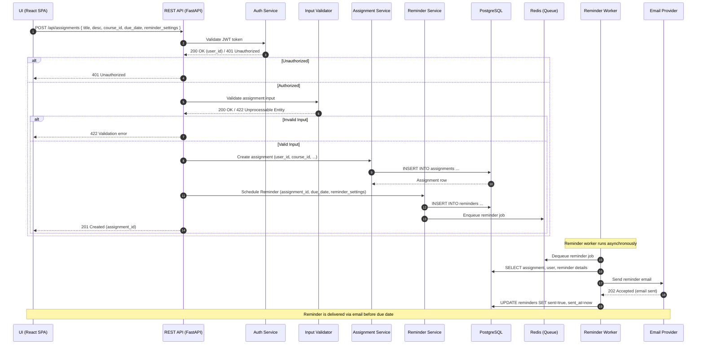

# Student Assignment Organizer

> Manage your university assignments and exams effortlessly.

A low-fidelity prototype of **Student Assignment Organizer**, generated by an agentic AI project manager from a stakeholder conversation in Slack.

## Screens

- [Home](index.html) — Landing page with links to key features.
- [Course Management](course_management.html) — Allows students to add and manage their courses.
- [Assignment Tracking](assignment_tracking.html) — Enables students to create assignments and track their progress.
- [Calendar View](calendar_view.html) — Displays assignments and exams in a calendar format.
- [Reminders](reminders.html) — Sends notifications for upcoming deadlines.
- [Progress Dashboard](dashboard.html) — Shows an overview of completed and pending tasks.

## What this prototype fakes

- This prototype fakes all functionality; no real data is processed.
- User accounts and reminders are fictitious; actual implementations are not present.

## System design

### Student Assignment Organizer – Use Case Diagram

This use case diagram maps all primary actors (Student, Admin, Notification Provider, Auth Service), grouping use cases into nested subgraphs for each feature area. For example, Course Management handles adding and editing courses, while Assignment Tracking covers creating, updating, deleting, and marking assignments as done. Cross-feature dependencies like authentication and validation are included, with external system actors present where their interactions are necessary (e.g., sending reminders). Edges illustrate which actor may use which feature and label extend/include relationships. This design closely models the required functional flows and assures coverage of both human and system actors.

### Student Assignment Organizer – Architecture Diagram

This diagram details the layered architecture of the platform. The client layer is a React SPA interfacing with a REST API (FastAPI). The API delegates business logic by feature modules (user, course, assignment, calendar, reminders, and dashboard). Reminders are handled via background workers using a Redis queue, and outgoing notification flows are shown towards SMTP and push providers. PostgreSQL stores persistent data and a Redis cache supports high-read and job-queuing needs. Cross-cutting concerns, including auth, logging, and monitoring, are highlighted as standalone modules. Major design decisions visible are the separation of background job processing for reminders and the use of an API gateway for secure, validated, and authenticated interactions.

### Student Assignment Organizer – Entity-Relationship Diagram

This ERD models all persistent entities required for functional completeness. The central USER entity relates to COURSE (a student can enroll in many courses), and ASSIGNMENT (each assignment belongs to a course and a user). REMINDER entities are linked to assignments, supporting scheduled and sent notifications. Settings/preferences like REMINDER_PREF are attached to each user. A join table ENROLLMENT supports the many-to-many course-user association. This captures both domain and supporting entities, ensuring both assignments and courses are private per user.

### Add Assignment and Schedule Reminder – Sequence Diagram

This diagram illustrates the end-to-end flow for a student adding a new assignment, including authentication, input validation, database insertion, and the background reminder job scheduling and email sending. Alternate flows, like invalid input or unauthorized access, are specified in alt blocks. The reminder scheduling and eventual notification (via a background worker and third-party email service) highlight asynchronous cross-layer interactions crucial for the reminders feature.

## Running it

Every file is static. Open `index.html`, or serve the directory with any static file server.
