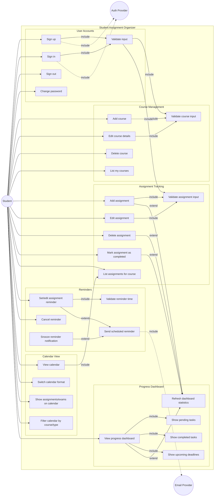
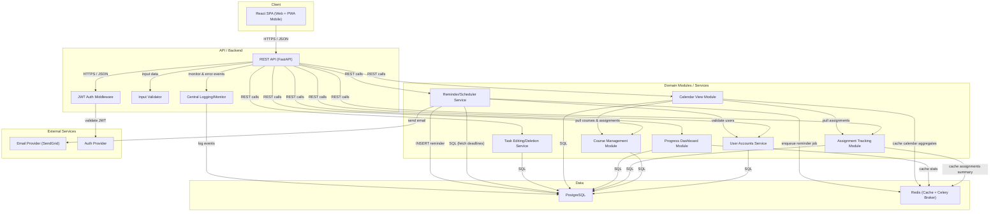
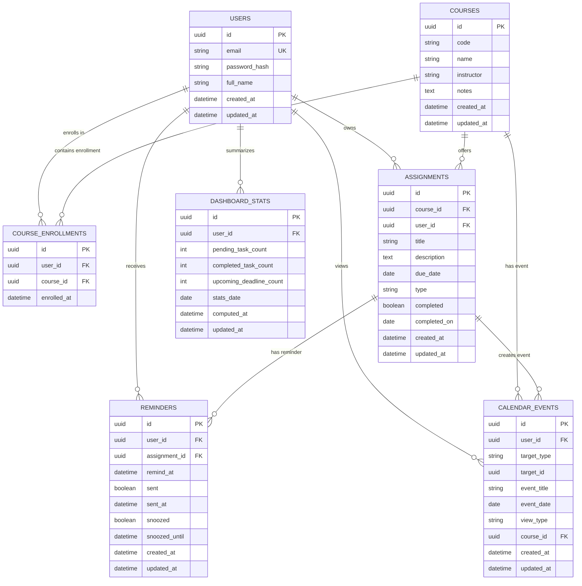
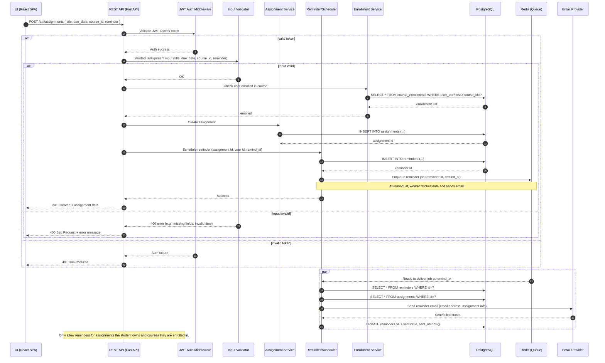

# Student Assignment Organizer

> Manage your assignments and exams easily.

A low-fidelity prototype of **Student Assignment Organizer**, generated by an agentic AI project manager from a stakeholder conversation in Slack.

## Screens

- [Home](index.html) — The landing page where students can navigate to key features.
- [Course Management](course_management.html) — Add and manage courses within the platform.
- [Assignment Tracking](assignment_tracking.html) — Create and track assignments with due dates.
- [Calendar View](calendar_view.html) — Visualize assignments and exams in a calendar format.
- [Progress Dashboard](progress_dashboard.html) — View pending tasks, completed tasks, and upcoming deadlines.

## What this prototype fakes

- This prototype fakes the core functionality and does not include persistent data storage.
- No real calendar integration or reminder system is implemented; these features are conceptually included.

## System design

### Student Assignment Organizer Use Case Diagram

This use case diagram depicts the interactions between the Student actor and the key use cases supported by the platform, grouped by feature area. Supporting internal use cases, such as authentication, data validation, and scheduled reminder dispatch, are included and show explicit dependencies via include/extend relationships. The diagram also visualizes the external systems in play: the Auth Provider for identity services and the Email Provider for outgoing reminders. The structure highlights the functional requirements such as CRUD operations for courses and assignments, dashboard viewing, calendar navigations, personal account management, and reminder scheduling with comprehensive coverage of user flows.

### System Logical Architecture

This architecture diagram shows the full technology stack and flow of control. The frontend client is a React SPA targeting web and mobile, connecting securely via HTTPS to a FastAPI REST API backend. The backend includes JWT authentication, input validation, and logging modules, as well as specialized microservices for user management, course and assignment operations, reminder scheduling, calendar computation, and dashboard analytics. Data is persisted in PostgreSQL, while Redis provides rapid cache access and Celery integration for background job dispatch (notably reminders). Email reminders are sent through a third-party provider. Operational health, audit, and metrics are cross-cutting, ensuring error detection and observability. The layering and module choices enable clean scalability, robustness, and separation of concerns aligning directly with requirements.

### Persistent Data Model (ERD)

This entity-relationship diagram expresses all required persistent entities: USERS, COURSES, ASSIGNMENTS, REMINDERS, CALENDAR_EVENTS, DASHBOARD_STATS, and the COURSE_ENROLLMENTS join table. Each table's keys, relevant foreign keys, and attributes directly support the requirements; for example, assignments are linked to both courses and users and track status and deadlines, while reminders preserve delivery state for audits and snooze. CALENDAR_EVENTS captures recurring or one-time displayable items (assignments, exams). The COURSE_ENROLLMENTS table handles user-specific course membership, enabling extension for future roles. Normalization and explicit associations assure private, per-user organization, and fine-grained tracking for reminders, calendar, and progress computations.

### Add Assignment with Deadline Reminder Flow

This end-to-end flow tracks a student's adding an assignment with an optional deadline reminder set, passing through authentication, input validation, data persistence, and asynchronous reminder scheduling. The flow covers token verification, domain layer orchestration, entity creation, and reminder queue/dispatch. It also models user-triggered errors (such as validation failures), and includes note annotations where business rules apply, for example, ensuring that a user cannot set reminders for assignments not owned by them or in non-enrolled courses. This sequence shows the system's robustness, modularity, and how asynchronous flows keep user experience fast despite scheduled jobs and external dependencies.

## Running it

Every file is static. Open `index.html`, or serve the directory with any static file server.
